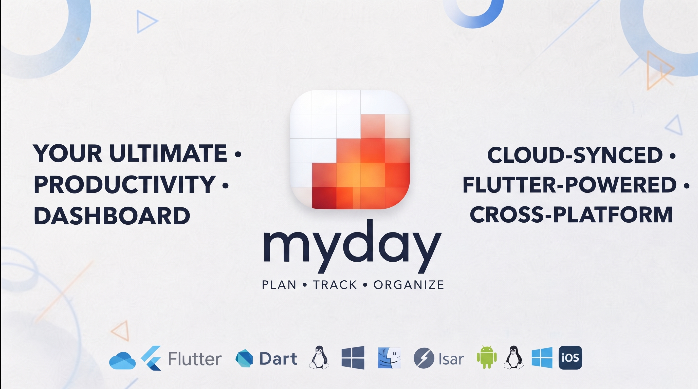
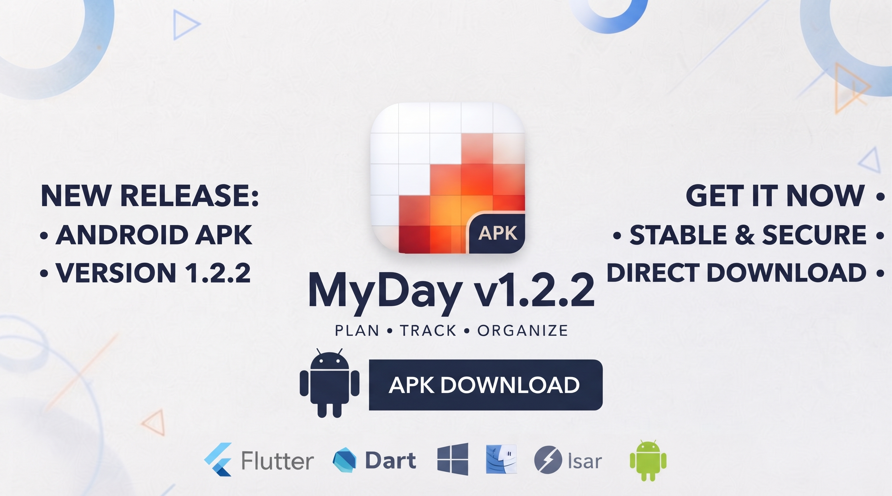

<div align="center">



# MyDay (Pocketdesk v2)

**Your offline-first, privacy-respecting productivity, communication & life ecosystem.**

*Plan • Track • Communicate • Focus*

<br>

[](https://flutter.dev)
[](https://dart.dev)
[](https://developer.android.com)
[](https://flutter.dev/desktop)
[](https://drift.simonbinder.eu/)
[](LICENSE)
[](https://github.com/Aaryanbanskota/Pocket-Desk/releases)

<br>

[📥 Android Downloads](#-android-downloads) ·
[🐧 Linux Desktop](#-linux-desktop-downloads) ·
[✨ Features](#-features) ·
[🏗 Architecture](#-architecture) ·
[🚀 Quick Start](#-quick-start-development) ·
[🤝 Contributing](#-contributing)

</div>

---

## 📖 About

**MyDay (Pocketdesk v2)** is an offline-first productivity and communication ecosystem built with Flutter.  
It combines a dual-calendar engine (**Gregorian AD & Bikram Sambat BS**), full-featured **Task Manager**, **Rich Notes**, **Money Health / Wallet Tracker**, **VoIP Voice Calling**, **P2P Messaging**, **Interactive Android Home Widgets**, and a **Hardware Biometric Shield** into a unified, secure experience — without requiring persistent cloud connections.

> **Privacy Manifesto:** You own your data. Everything works 100% offline through local SQLite/Drift caching. Network access is strictly used for peer-to-peer encrypted sync, Supabase-signaled VoIP calling, and verified in-app update checks.

### Platform Support

| Platform | Status |
|:---------|:-------|
|  **Android** (API 24+) | ✅ Full Support (Home Widgets, Biometrics, CallKit/Notifications) |
|  **Linux / Ubuntu** | ✅ Full Desktop Client |
|  **Windows** | 🔜 In Development |
|  **macOS** | 🔜 In Development |

---

## ⚡ What's New in v1.2.2 Release

- 📅 **Dual Calendar Engine (Gregorian AD & Bikram Sambat BS)**:
  - 4-Stream Calendar Hub featuring seamless bi-directional BS/AD date conversion.
  - Native Nepali festival detection, Tithi astronomical lunar calculations, and holiday schedules.
  - Multi-stream views: Day, Week, Month, Year, and Agenda timelines.
- 📞 **Voice Calling (VoIP) & Low-Latency Audio Streaming**:
  - Full-duplex raw 16-bit PCM audio pipeline with dynamic jitter buffer and soft-limiter clipping prevention.
  - Supabase/P2P signaling engine with custom DTMF dialer, ringtones, and lock-screen incoming call display.
- 💬 **Enhanced Real-time Messaging**:
  - Peer-to-peer real-time delivery with accurate state tracking (`sending` $\rightarrow$ `sent` double-check indicator).
  - Silent sender audio feedback and reliable cross-region delivery.
- 📱 **Android Home Screen Widgets**:
  - Interactive Glance/HomeWidget integration: Agenda, Tasks, Budget, Clock, Notes, and Quick Action launchers directly on your home screen.
- 🛡️ **Hardware Biometric Shield & App Lock**:
  - Hardware biometric security (Fingerprint / Face Unlock) paired with SHA-256 PIN authentication.
  - Immediate App Lock Overlay shielding sensitive screen content during lifecycle background pauses.
- 🔄 **Supabase Throttled In-App Update Engine**:
  - Automated 6-hour database throttled update checks (or manual check from About screen) minimizing network overhead.
  - Direct release APK downloader with native Android `PackageInstaller` integration.
- 🛠️ **Developer Mode & System Diagnostics**:
  - Secret 10-tap unlock on app version in Settings > About App.
  - Real-time diagnostic monitors: hardware memory, standby database encryption, runtime environment metrics, and decrypted local database inspector.
- 🗄️ **SQLite 3 & Drift ORM Migration**:
  - High-performance, strongly-typed relational persistence layer providing offline-first reactive stream queries.

---

## 📥 Downloads & Releases

### 🤖 Android Downloads

<div align="center">
  
</div>

| Build Type | Download | Recommended For |
|:-----------|:---------|:----------------|
| **Release APK** | [📥 Download app-release.apk](https://github.com/Aaryanbanskota/Pocket-Desk/raw/main/all-apk/app-release.apk) | Direct sideloading on all Android devices (API 24+) |
| **Release APK (v1.2.2)** | [📥 Download MyDay-v1.2.2-release.apk](https://github.com/Aaryanbanskota/Pocket-Desk/raw/main/all-apk/MyDay-v1.2.2-release.apk) | Version-pinned archive |

> **Installation Note:** Allow "Install unknown apps" in Android settings when installing downloaded APKs.

### 🐧 Linux Desktop Downloads

<div align="center">
  
</div>

| Platform | Download | Architecture |
|:---------|:---------|:-------------|
| **Linux Desktop** | [🐧 Download tar.gz](https://github.com/Aaryanbanskota/Pocket-Desk/blob/main/pocketdesk-linux-x64.tar.gz) | x86_64 / Ubuntu 20.04+ |

#### Linux Quick Run

```bash
# Extract and launch
tar -xzf pocketdesk-linux-x64.tar.gz
cd bundle
./pocketdesk
```

---

## ✨ Features

<table>
<tr>
<td width="50%" valign="top">

### 📅 Dual Calendar Hub (AD & BS)
- Dual Gregorian (AD) and Bikram Sambat (BS) calendar engine
- Bi-directional instant conversion algorithm
- Full Nepali holiday schedules, Tithi calculations, and festivals
- Multi-view display: Day, Week, Month, Year, and Agenda
- Full RFC 5545 recurrence rules and offline ICS export/import

</td>
<td width="50%" valign="top">

### 📞 VoIP Voice Calling & Messaging
- Low-latency 16-bit raw PCM streaming over P2P/WebSockets
- Soft limiter, AGC, and dynamic jitter buffer for crystal audio
- Supabase-signaled calling with custom ringtones & DTMF dialer
- Full lock-screen and heads-up incoming call notifications
- P2P messaging with live `"sending"` / `"sent"` delivery indicators

</td>
</tr>
<tr>
<td width="50%" valign="top">

### ✅ Task & Project Management
- Subtasks checklists with real-time completion progress
- Priority tags (Urgent, High, Medium, Low) and due dates
- Compact modal task preview and quick-edit sheets
- Swipe-to-archive workflows and history logs

</td>
<td width="50%" valign="top">

### 📝 Rich Note Ecosystem
- Markdown formatting: code blocks, checklists, headings
- Media attachments: Images, audio memos, PDF files, drawings
- Organization by tags, color-coding, folders, and full-text search
- Live auto-save and transactional state preservation

</td>
</tr>
<tr>
<td width="50%" valign="top">

### 💰 Money Health & Wallet
- Multi-account balance tracker and categorized expenses
- Spending analytics, monthly burn rate, and category breakdowns
- **AI Spending Score (0–100)** with personalized budgeting advice
- Transaction search, date filters, and export capabilities

</td>
<td width="50%" valign="top">

### 📱 Android Home Screen Widgets
- Interactive widgets for your Android home screen
- **Agenda Widget**: Upcoming events at a glance
- **Tasks Widget**: Quick checkbox completion without opening the app
- **Budget Widget**: Daily spend and wallet balance
- **Quick Action Launcher**: One-tap note, event, or expense entry

</td>
</tr>
<tr>
<td width="50%" valign="top">

### 🔐 Hardware Biometric Shield & Security
- Fingerprint and Face Unlock via Android BiometricPrompt
- Secure PIN with salted SHA-256 fallback protection
- Instant App Lock Overlay shielding app screen on task switch
- Zero cloud telemetry, zero remote tracking, 100% data sovereignty

</td>
<td width="50%" valign="top">

### 🛠️ Developer Mode & Diagnostics
- Secret 10-tap version unlock in Settings > About App
- Standby database encryption and decrypted data inspector
- Live memory footprint, frame rendering stats, and OS metrics
- Throttled in-app update checker powered by Supabase

</td>
</tr>
</table>

---

## 🏗 Architecture

MyDay follows **Clean Architecture** with a modular, feature-first structure:

```text
lib/
├── app/                      # App root, multi-provider bindings, router setup
├── core/
│   ├── database/             # SQLite 3 / Drift ORM database & migrations
│   ├── error/                # AppFailure types & GlobalErrorBoundary
│   ├── logging/              # AppLogger structured logging
│   ├── router/               # GoRouter declarative navigation
│   ├── security/             # Biometric shield, PIN auth & app lock overlay
│   ├── sync/                 # P2P delta sync, encryption & signaling
│   ├── theme/                # Design tokens, dark/light modes & typography
│   ├── update/               # Throttled Supabase update checker & installer
│   └── utils/                # Date converters (BS/AD), validators & formatters
└── features/
    ├── about/                # About App, version tap trigger & Developer Mode
    ├── calendar/             # 4-Stream AD/BS calendar hub & festival engine
    ├── call/                 # VoIP calling, PCM audio pipeline & DTMF dialer
    ├── chat/                 # P2P messaging, status indicators & attachments
    ├── dashboard/            # Home hub, overview cards & quick actions
    ├── developer/            # Developer mode diagnostics & database inspector
    ├── money/                # Wallet balances, expense tracking & AI score
    ├── notes/                # Rich text notes, attachments & organization
    ├── tasks/                # Tasks, subtasks checklists & priority queues
    └── widgets/              # Android HomeWidget synchronization service
```

### Tech Stack

| Layer | Technology |
|:------|:-----------|
| **Framework** | [Flutter 3.24](https://flutter.dev) (Dart 3.5) |
| **State Management** | [Flutter Riverpod](https://riverpod.dev) (code-generated providers) |
| **Routing** | [GoRouter](https://pub.dev/packages/go_router) |
| **Primary Database** | [Drift ORM](https://drift.simonbinder.eu/) + [SQLite 3](https://sqlite.org) |
| **Legacy / Standby DB** | [Isar Database](https://isar.dev) |
| **Dual Calendar** | `nepali_utils`, `nepali_date_picker`, custom BS/AD algorithms |
| **VoIP & Audio** | Raw 16-bit PCM streaming, `audioplayers`, WebRTC/Socket signaling |
| **Home Widgets** | Android AppWidget Provider via `home_widget` |
| **Security** | `local_auth` (Biometrics), `crypto` (SHA-256), `flutter_secure_storage` |
| **In-App Updates** | Throttled Supabase Client + Android `PackageInstaller` |

---

## 🚀 Quick Start (Development)

### Prerequisites

- **Flutter SDK**: `3.24.0` (managed via [FVM](https://fvm.app/) or standard Flutter install)
- **Dart SDK**: `^3.5.0`
- **Android SDK**: API 34 target (API 24 minimum)
- **Java / JDK**: 17+

### Setup

```bash
# 1. Clone repository
git clone https://github.com/Aaryanbanskota/Pocket-Desk.git
cd Pocket-Desk

# 2. Install dependencies
flutter pub get

# 3. Generate Drift database & Riverpod code
dart run build_runner build --delete-conflicting-outputs

# 4. Run test suite (132+ passing unit & widget tests)
flutter test

# 5. Launch debug session
flutter run
```

### Build Releases

```bash
# Android Universal Release APK
flutter build apk --release

# Android App Bundle (AAB for Play Store)
flutter build appbundle --release

# Linux Desktop Release
flutter build linux --release
```

---

## 🤝 Contributing

Contributions, bug reports, and suggestions are welcome!

1. Fork the repository
2. Create your feature branch (`git checkout -b feature/AmazingFeature`)
3. Commit your changes (`git commit -m 'feat: Add some AmazingFeature'`)
4. Push to the branch (`git push origin feature/AmazingFeature`)
5. Open a Pull Request

---

## 📄 License

This project is licensed under the **MIT License**. See the [LICENSE](LICENSE) file for details.

---

<div align="center">

**Made with ❤️ using Flutter**

*Plan • Track • Communicate • Focus*

⭐ [Star this repo](https://github.com/Aaryanbanskota/Pocket-Desk) · 🐛 [Report Issue](https://github.com/Aaryanbanskota/Pocket-Desk/issues)

</div>
